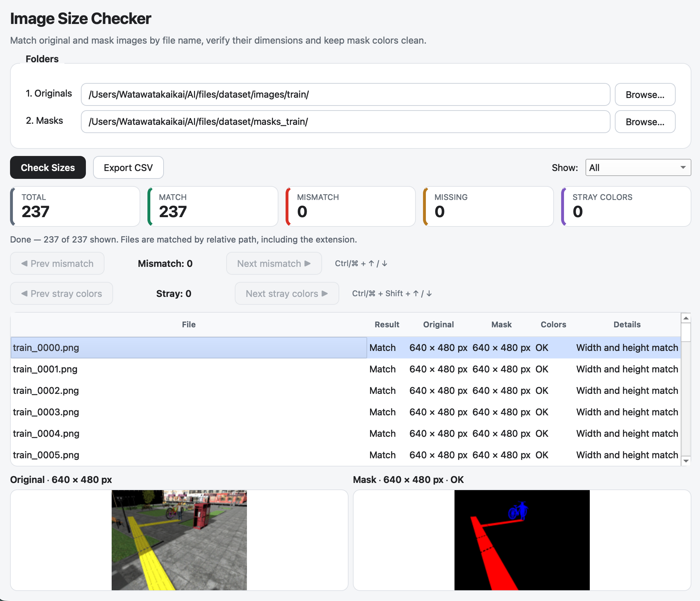
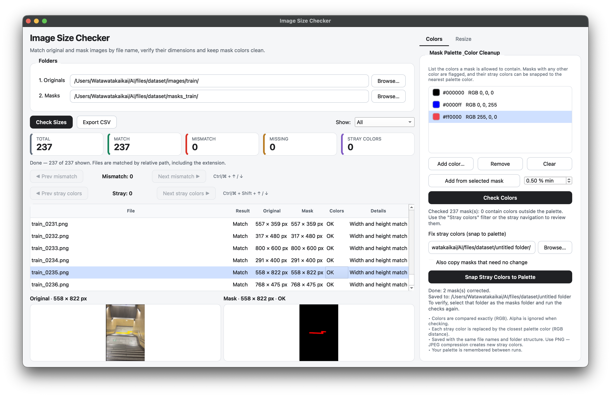
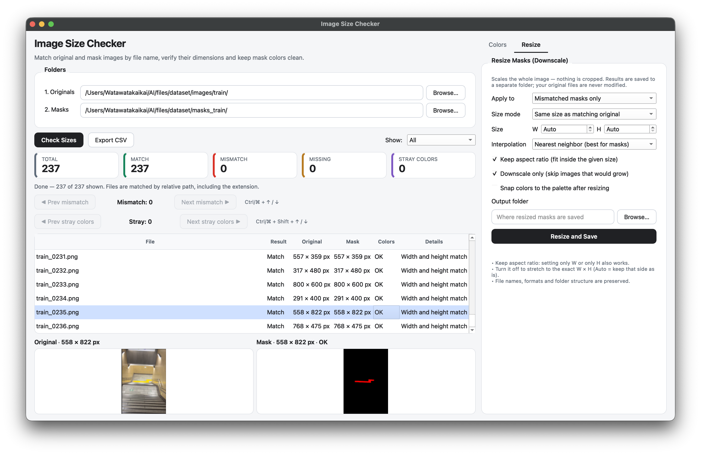

# Image Check

**English** | [日本語](#日本語)

A small desktop tool (Python + PySide6) that matches an **original-image folder** against a **mask-image folder** by file name, checks that their pixel dimensions agree, keeps **mask colors clean**, and lets you **downscale mask images** to any size when they don't match.



## Features

- **Bulk size check** — compares width × height for every original/mask pair (subfolders included).
- **Side-by-side preview** — select a row to see the original and the mask next to each other.
- **Jump between mismatches** — Prev / Next buttons, a clickable *MISMATCH* counter, or `Ctrl/⌘ + ↑ / ↓`.
- **Mask palette & color cleanup** — define the colors a mask may contain, find masks with stray colors, and snap those colors to the nearest palette color.
- **Filter** — show all, mismatches, missing counterparts, matches, or masks with stray colors.
- **Resize masks (downscale)** — scale the *whole* image (no cropping) to a custom size or to the size of the matching original. Optionally snap colors to the palette afterwards. Results go to a separate folder; your files are never overwritten.
- **CSV export** — save the result table (UTF-8 with BOM, opens cleanly in Excel).

## Requirements

- Python 3.9 or later
- [PySide6](https://pypi.org/project/PySide6/)
- [Pillow](https://pypi.org/project/Pillow/)
- [NumPy](https://pypi.org/project/numpy/)

## Installation

```bash
pip install PySide6 Pillow numpy
```

## Usage

```bash
python image_check.py
```

1. Choose the **Originals** folder and the **Masks** folder.
2. Press **Check Sizes**.
3. Review the table. Use **Prev / Next mismatch** to jump to problem files. Supported formats: PNG, JPEG, WebP, BMP, GIF, TIFF.
4. (Optional) Clean mask colors in the **Colors** tab (see below).
5. (Optional) Resize masks in the **Resize** tab, then press **Resize and Save**.
6. (Optional) Press **Export CSV** to save the results.

### How files are matched

Files are paired by their **relative path, case-insensitive, including the extension**. For example, `a/photo01.jpg` in the originals folder is paired with `a/photo01.jpg` in the masks folder. If your originals are `.jpg` but your masks are `.png`, they will show up as *Missing* — rename or convert one side first.

### Mask palette & color cleanup (Colors tab)



Resizing or compressing a mask can introduce stray colors, and masks from different sources may use slightly different colors. The Colors tab fixes this in three steps:

1. **Define the palette** — the colors a mask is allowed to contain.
   - **Add color…** opens a color picker (hex / RGB).
   - **Add from selected mask** takes the most frequent colors of the mask selected in the table (colors covering at least the given share of pixels). Remove any you don't want.
   - Your palette is remembered between runs.
2. **Check Colors** — every mask is scanned. Masks containing any color outside the palette are marked in the *Colors* column and counted in the *STRAY COLORS* card. Use the **Stray colors** filter or the *Prev / Next stray colors* buttons (`Ctrl/⌘ + Shift + ↑ / ↓`) to review them.
3. **Snap Stray Colors to Palette** — every stray color is replaced by the nearest palette color (RGB distance) and saved to an output folder. Enable *Also copy masks that need no change* to get a complete set in one folder.

Notes: colors are compared exactly in RGB, alpha is ignored when checking (it is preserved when snapping), and grayscale masks stay grayscale if the palette is all gray. Use **PNG** for masks — JPEG compression creates new stray colors.

### Resize options (Resize tab)



| Option | Description |
| --- | --- |
| Apply to | All mask images, or only the mismatched ones. |
| Size mode | **Custom size** (enter W and/or H) or **Same size as matching original**. |
| Keep aspect ratio | Fit inside the given size without distortion. W or H alone is enough. When off, the image is stretched to the exact W × H (`Auto` keeps that side unchanged). |
| Downscale only | Skip images that would need to be enlarged. |
| Interpolation | **Nearest neighbor** keeps label values intact (recommended for masks). **Smooth (LANCZOS)** produces blended edge colors. |
| Snap colors to the palette | After resizing, replace stray colors (e.g. from smooth interpolation) with the nearest palette color. |
| Output folder | Where resized masks are saved. File names, formats and subfolder structure are preserved. Must differ from the input folders. |

After resizing or fixing colors, select the output folder as the masks folder and run the checks again to confirm that everything is clean.

### Notes

- Sizes are read from the raw image data; EXIF orientation is not applied.
- Animated GIFs are saved with their first frame only when resized or snapped.
- JPEG masks are re-encoded (quality 95) when saved.
- Masks are expected to be 8-bit images (16-bit images are not supported for color checks).

## License

This project is released under the [MIT License](LICENSE). Third-party libraries (PySide6, Pillow, NumPy) are distributed under their own licenses.

---

<a id="日本語"></a>

# Image Check（日本語）

[English](#image-check) | **日本語**

**元画像フォルダ**と**マスク画像フォルダ**をファイル名で照合し、ピクセルサイズが一致しているかを一括で確認するデスクトップツール（Python + PySide6）です。マスクの**色をきれいに保つ**機能と、サイズが合わないマスクを任意のサイズへ**縮小**する機能も備えています。


## 主な機能

- **サイズの一括チェック** — 元画像とマスクの幅×高さを全ペアで比較します（サブフォルダ対応）。
- **並べてプレビュー** — 行を選ぶと、元画像とマスクを左右に表示します。
- **不一致へジャンプ** — 「Prev / Next mismatch」ボタン、クリックできる *MISMATCH* カウンター、または `Ctrl/⌘ + ↑ / ↓` で移動できます。
- **マスクのパレット指定と減色** — マスクに使ってよい色を指定し、それ以外の色を含むマスクを見つけ、指定色の中で最も近い色へ書き換えます。
- **フィルタ** — すべて／不一致／相手なし／一致／指定外の色を含むマスク、を切り替えられます。
- **マスクのリサイズ（縮小）** — トリミングせず画像全体を、任意のサイズ、または対応する元画像のサイズへ拡大縮小します。リサイズ後にパレットへの減色もまとめて行えます。結果は別フォルダへ保存され、元のファイルは上書きされません。
- **CSV書き出し** — 結果一覧を保存できます（BOM付きUTF-8のため、Excelでも文字化けしません）。

## 必要環境

- Python 3.9 以上
- [PySide6](https://pypi.org/project/PySide6/)
- [Pillow](https://pypi.org/project/Pillow/)
- [NumPy](https://pypi.org/project/numpy/)

## インストール

```bash
pip install PySide6 Pillow numpy
```

## 使い方

```bash
python image_check.py
```

1. **Originals**（元画像）フォルダと **Masks**（マスク画像）フォルダを選びます。
2. **Check Sizes** を押します。
3. 結果の表を確認します。**Prev / Next mismatch** で問題のあるファイルへ移動できます。対応形式は PNG / JPEG / WebP / BMP / GIF / TIFF です。
4. （任意）**Colors** タブでマスクの色を整えます（下記参照）。
5. （任意）**Resize** タブでマスクをリサイズし、**Resize and Save** を押します。
6. （任意）**Export CSV** で結果を保存します。

### ファイルの照合ルール

ファイルは、**拡張子を含む相対パス（大文字小文字は区別しない）**で照合します。たとえば、元画像フォルダの `a/photo01.jpg` は、マスクフォルダの `a/photo01.jpg` と対になります。元画像が `.jpg` でマスクが `.png` の場合は *Missing*（相手なし）と表示されるため、どちらかの拡張子をそろえてください。

### マスクのパレット指定と減色（Colors タブ）


マスクをリサイズ・圧縮すると、意図しない色（ゴミ）が混ざることがあります。また、作成元が違うマスクでは色がわずかにずれていることもあります。Colors タブでは、次の3ステップで解決します。

1. **パレットを決める** — マスクに使ってよい色を登録します。
   - **Add color…** でカラーピッカー（16進／RGB）から追加します。
   - **Add from selected mask** は、表で選択中のマスクから、使用頻度の高い色（指定した割合以上のピクセルを占める色）を追加します。不要な色は削除してください。
   - パレットは次回起動時にも保持されます。
2. **Check Colors** — すべてのマスクを走査します。パレット外の色を含むマスクは *Colors* 列に表示され、*STRAY COLORS* カードに数が出ます。**Stray colors** フィルタや「Prev / Next stray colors」ボタン（`Ctrl/⌘ + Shift + ↑ / ↓`）で確認できます。
3. **Snap Stray Colors to Palette** — パレット外の色をすべて、最も近いパレットの色（RGB距離）に置き換えて、出力フォルダへ保存します。*Also copy masks that need no change* をオンにすると、変更不要のマスクも一緒にコピーされ、1つのフォルダに全量がそろいます。

補足：色はRGBで完全一致かどうかを判定します。チェック時はアルファを無視し、書き換え時はアルファを保持します。パレットがすべてグレーなら、グレースケールのマスクはグレースケールのまま保存されます。マスクには **PNG** をおすすめします（JPEGは圧縮で新たな不要色が発生します）。

### リサイズのオプション（Resize タブ）


| 項目 | 説明 |
| --- | --- |
| Apply to | すべてのマスク画像、または不一致のマスクのみ。 |
| Size mode | **Custom size**（W・Hを入力）または **Same size as matching original**（対応する元画像と同じサイズ）。 |
| Keep aspect ratio | 縦横比を保ったまま、指定サイズの枠内に収めます。WかHのどちらか片方だけでも使えます。オフにすると、指定した W × H に引き伸ばします（`Auto` の辺は元のサイズのまま）。 |
| Downscale only | 拡大が必要な画像はスキップします。 |
| Interpolation | **Nearest neighbor**（最近傍）はラベル値が混ざらないため、マスクにおすすめです。**Smooth (LANCZOS)** は境界に中間色が生じます。 |
| Snap colors to the palette | リサイズ後に、パレット外の色（滑らかな補間で生じた色など）を最も近いパレットの色へ置き換えます。 |
| Output folder | リサイズ結果の保存先です。ファイル名・形式・サブフォルダ構造は保持されます。入力フォルダとは別のフォルダを指定してください。 |

リサイズや減色のあとは、出力フォルダを Masks フォルダとして選び直し、もう一度チェックを実行すると、すべて問題ないか確認できます。

### 注意事項

- サイズは画像データそのままの値で判定し、EXIFの回転情報は考慮しません。
- アニメーションGIFは、リサイズ・減色時に最初のフレームのみが保存されます。
- JPEGのマスクは、保存時に再エンコード（品質95）されます。
- 色のチェックは8bit画像を前提としています（16bit画像は未対応）。

## ライセンス

このプロジェクトは [MIT License](LICENSE) で公開しています。利用しているライブラリ（PySide6、Pillow、NumPy）は、それぞれのライセンスに従います。
